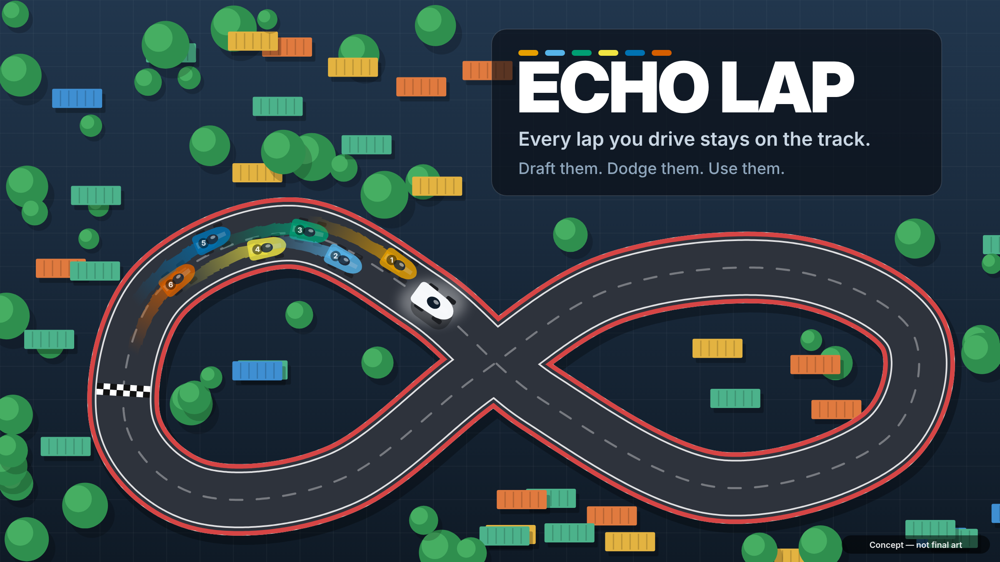
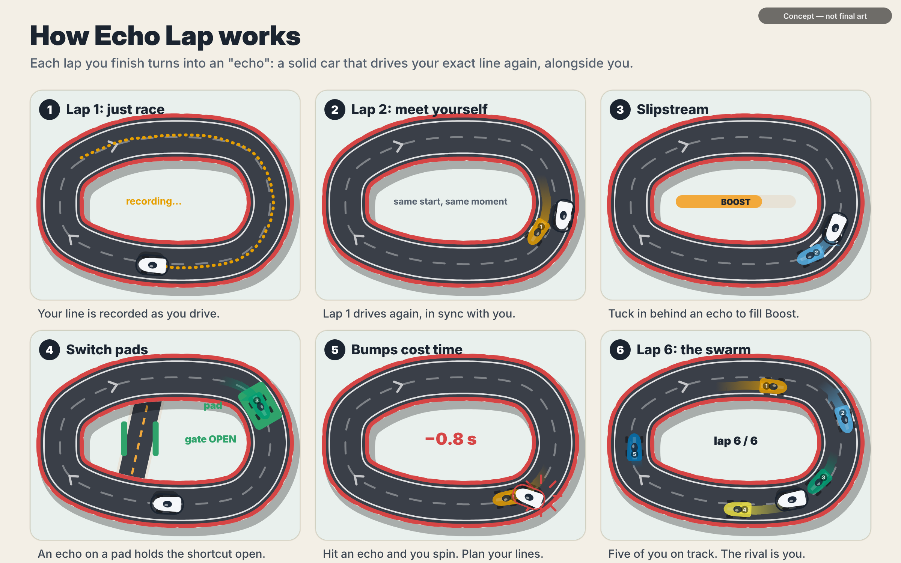
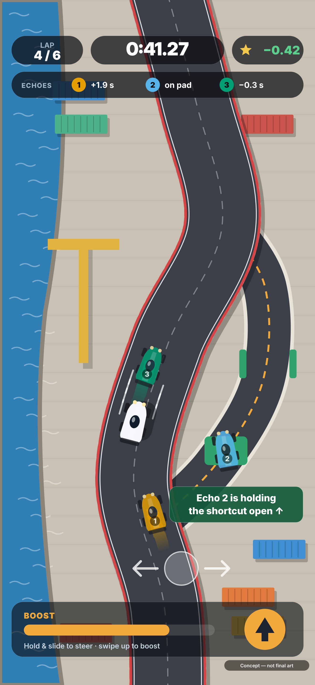
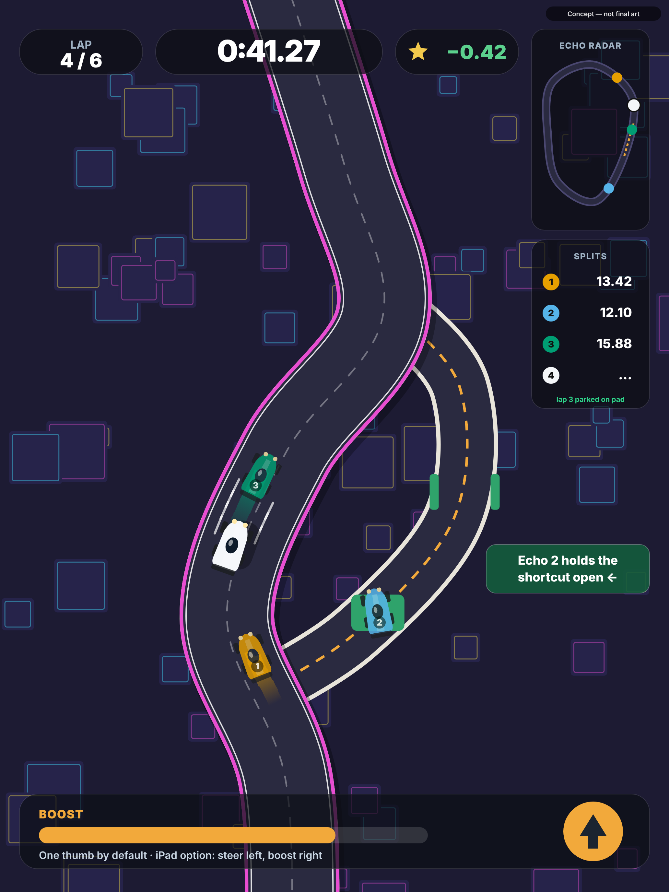
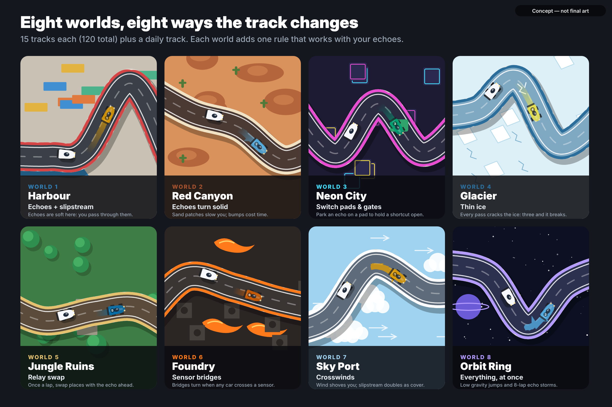
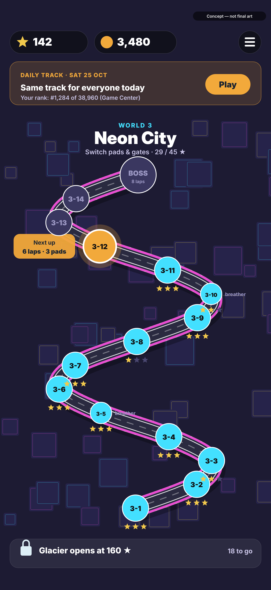
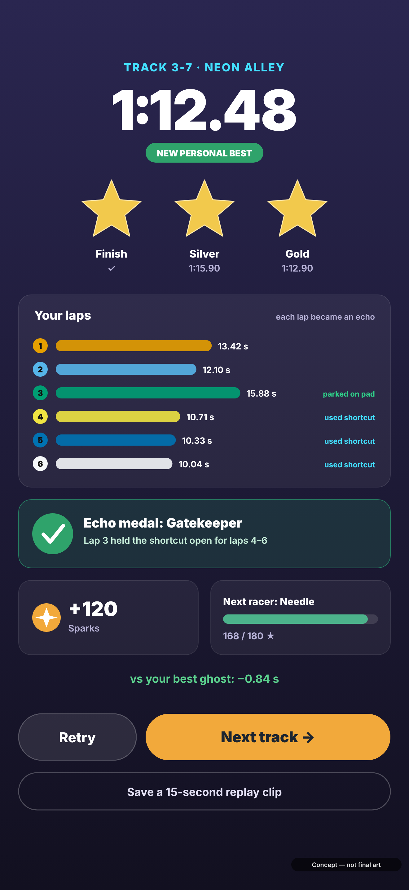
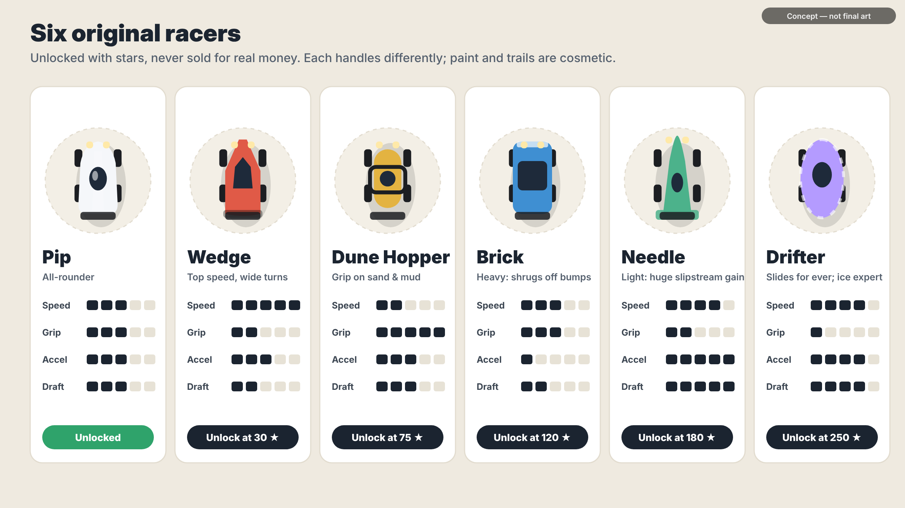

# Concept brief: ECHO LAP (working title)

Stage 1 · prepared 25 Oct 2026 · iPhone and iPad · images in `concept/images/`

> **Every lap you drive stays on the track.** Each lap you finish turns into an *echo*: a solid car that drives your exact line again, right alongside you. Tuck in behind your echoes for boost, park one on a switch to hold a shortcut open, and learn to dodge your own mistakes. By lap 6 you're racing five versions of yourself.

---

## B1. Six twists, scored

Each twist was checked against existing games before scoring (searches on 25 Oct 2026; see `research/notes/genre-themes.md`, section 5).

| | Twist | In one line | Closest existing game |
|---|---|---|---|
| **A** | **Echo Lap** | Each finished lap becomes a solid echo car you draft, dodge and use to hold switches. | *Does Not Commute* (2015): earlier drives replay as traffic you must avoid, in a commute puzzle. Two free jam games (*Everlapping*, *ReRun*) make echoes pure obstacles on one circuit. **None makes echoes a tool, and none is a full racing game.** |
| B | Fold | The road is printed on paper; flick to fold the sheet and bring a far stretch of road next to you. | None found among racing games. *Paper Trail* (PC puzzle) folds a map, not a race track. |
| C | Pulse Track | Track sections shift on a fixed beat; read the rhythm and ride it. | Music racers (*Riff Racer*) build a track from songs, but it doesn't move while you race. |
| D | Ink Line | Draw your racing line; the car follows it. | *DrawRace 1 & 2* (2009/2011) and *Draw Drift* already do exactly this. |
| E | Track Layer | Lay road tiles in front of your speeding car from a hand of three. | *Infinity Track* (iOS, with a train) and the web game *Dude, Where's my Road?* |
| F | Gravity Flip | Tap to flip the world; drive on the ceiling. | *Monorace* (2010), *Gravity Runner*. |

**Scoring:** 1 = poor, 5 = excellent. "Safety" = low technical, review and legal risk.

| Criterion | A Echo | B Fold | C Pulse | D Ink | E Layer | F Gravity |
|---|---|---|---|---|---|---|
| 1. Novelty (passes 4.3, one-sentence pitch) | 3 | **5** | 4 | 1 | 2 | 2 |
| 2. Fun within 30 seconds | **5** | 4 | 4 | 4 | 3 | 4 |
| 3. One thumb on iPhone, good on iPad | **5** | 3 | 4 | 4 | 4 | **5** |
| 4. Buildable in SpriteKit 2.5D, code-drawn | **5** | 3 | 4 | 4 | 4 | 4 |
| 5. Depth for 100+ rising levels | **5** | 4 | 4 | 3 | 4 | 3 |
| 6. Fixes the gaps from research | **4** | **4** | 3 | 3 | 3 | 3 |
| 7. Works in "can you beat this?" videos | 4 | **5** | 4 | 3 | 4 | 3 |
| 8. Takes purchases later without pay-to-win | 4 | 4 | 4 | 4 | 4 | 4 |
| 9. Safety | **4** | 3 | 3 | 3 | 3 | 3 |
| **Total (of 45)** | **39** | 35 | 34 | 29 | 31 | 31 |
| Total with novelty counted twice | **42** | 40 | 38 | 30 | 33 | 33 |

### Recommendation: A, Echo Lap. Runner-up: B, Fold.

- **Why Echo Lap wins:** it's the only twist that scores 5 on feel, one-thumb control, buildability *and* depth at once. You are always simply racing; the twist grows out of your own driving, so every player's race is different. It turns the brief's "ghost races" pillar into the main mechanic, and makes the track change as you race, because *you* change it.
- **The honest catch:** "past runs come back as cars" has been seen before (Does Not Commute, two jam games). Our new part is that **echoes are tools, not just obstacles**: slipstream boost, switch pads, relay swaps, thin ice your echoes break. And it is a full racing game with stars, worlds and target times. That is a clear, explainable difference for App Review, but less of a "never seen anything like it" moment than Fold.
- **Why Fold came second:** it's the most original idea (nothing like it found among racers) and looks great in videos, but it splits one thumb between steering and folding, the fold animation and collisions are harder to build in 2.5D, and it risks feeling more like a puzzle than a race. It's kept on file as a possible late world or a sequel.
- **Why the others lost:** Ink Line and Gravity Flip already exist almost exactly (DrawRace, Monorace). Track Layer exists with a train (Infinity Track) and plays more like a puzzle than a race. Pulse Track is fresh, but drifts towards an obstacle-course runner and feels less like racing.

---

## B2. Echo Lap in full

### The 30-second pitch, the way a player would tell a friend
"It's a racing game where every lap you finish stays on the track as a copy of your car. On lap 2 you're racing yourself from lap 1. Get right behind your old self and you get a speed boost. Later there are gates that only open while a car sits on a switch, so you can sacrifice a lap, park on the switch, and that copy holds the shortcut open for all your next laps. By lap 6 there are five of you on track and you have to weave through your own old lines. It's one thumb and the races are short. I keep restarting to make my earlier laps work better for my later ones."

### Core loop
| Time scale | What happens |
|---|---|
| **A moment (3 s)** | Steer through a bend, spot an echo ahead, tuck in behind it and feel the boost meter fill. |
| **One race (1–3 min)** | 2–8 laps. Each lap you finish joins the track as a new echo. Plan early laps so they help later ones: leave space, hold a switch, set up a slipstream train. Beat the gold time. |
| **One session (5–15 min)** | A few tracks on the world map, the daily track, one daily goal. Every race pays a fixed reward. |
| **The long game (weeks)** | 8 worlds with 120 tracks; 360 stars and 120 echo medals to collect; 6 racers to unlock; daily-track streaks and Game Center leaderboards; beat your own best-run ghost. |

### How echoes behave (the rules)
1. When you finish a lap, that lap is saved as an echo. Every echo starts from the start line at the same moment you start your next lap, and replays exactly what you did, mistakes included.
2. **Slipstream:** drive within about 1.5 car lengths behind any echo to fill Boost. Swipe up to spend it.
3. **Bumps:** echoes are solid from World 2 onward. Touch one and you spin out, losing about 0.6–1.0 s. In World 1 they're soft: you pass through with a small slowdown, so beginners learn safely.
4. **Echoes count as cars.** Anything a car can trigger, an echo can too: switch pads, sensors, cracking thin ice. That's how your earlier laps change the track for your later ones.
5. Echoes are colour-coded by lap with a colour-blind-safe palette, and each carries its lap number on the roof. Older echoes fade slightly so the newest ones stand out.

### Controls
- **One thumb, anywhere on the lower half of the screen:** touch down, then slide left or right to steer; how far you slide sets how sharply you turn. Lift your thumb to straighten. The car accelerates by itself.
- **Drift:** happens naturally when you steer hard at speed, with a haptic buzz while the tyres slide.
- **Boost:** swipe up anywhere. There's also an optional big boost button for players who prefer tapping.
- **Relay swap (World 5+):** double-tap to swap places with the echo directly ahead, once per lap.
- **Optional:** tilt steering in settings, and on iPad a two-thumb layout (steer left, boost right).
- **Haptics** on drift, slipstream lock-on, bumps and boost. Every touch target is at least 44 pt.
- **Orientation:** portrait on iPhone, so it plays one-handed on a bus. The camera turns with the car, so "up" is always forward; a fixed-camera option is in accessibility settings. iPad runs in portrait or landscape, with a pulled-back camera, a mini-map ("echo radar") and lap splits in the spare space.

 

### Worlds and tracks
**8 worlds × 15 tracks = 120 tracks**, plus a daily track and a weekly gauntlet. Each world adds one new rule that works with echoes, so the game keeps changing.

| World | Setting | New rule | What it adds |
|---|---|---|---|
| 1 | Harbour | Echoes and slipstream | Echoes are soft. Learn to draft. |
| 2 | Red Canyon | Echoes turn solid | Sand slows you. Bumps cost time, so lines matter. |
| 3 | Neon City | Switch pads and gates | A car on a pad holds a gate open. Sacrifice a lap to open a shortcut for later laps. |
| 4 | Glacier | Thin ice | Every pass (yours or an echo's) cracks the ice; three passes and it breaks into water. The track wears out as you race. |
| 5 | Jungle Ruins | Relay swap | Once per lap, swap places with the echo ahead and take its position. |
| 6 | Foundry | Sensor bridges | Bridges swing when any car crosses a sensor. Time your echoes to set the bridges for you. |
| 7 | Sky Port | Crosswinds | Wind pushes you sideways; an echo upwind shelters you, and slipstream doubles. |
| 8 | Orbit Ring | Everything | Low-gravity jumps, mixed rules, and 8-lap "echo storm" boss tracks. |

**Inside each world:** tracks 1–4 teach the new rule, track 5 is a short breather, tracks 6–9 combine it with earlier rules, track 10 is another breather, tracks 11–14 are the hard ones, and track 15 is a boss: a long track with one more lap than usual.

### How tracks are made and checked
1. **Generated from a number (a "seed").** The code places a few control points, joins them into a smooth closed circuit, and adds that world's features (pads, ice, bridges) by rule. A whole track is stored as one number plus a few settings, which keeps the download tiny.
2. **A robot driver tests every track before it ships.** It drives the track with the real game physics, including deliberate strategies such as parking on a pad. Tracks the robot can't finish, tracks where echoes could make a lap impossible, or tracks outside the target difficulty are thrown away and regenerated.
3. **The robot's best time sets the targets.** Gold and silver are its time plus a margin that shrinks as you progress.
4. **The daily track** comes from a pre-checked list of date seeds shipped inside the app (two years' worth), so everyone gets the same track each day with no servers. New seeds arrive with app updates.
5. **Boss tracks are hand-tuned** after generation. All other tracks come straight from the generator.

### Difficulty curve (track 1 → track 120)
| Setting | Track 1 | Track 30 (end of W2) | Track 60 (end of W4) | Track 90 (end of W6) | Track 120 (end of W8) |
|---|---|---|---|---|---|
| Laps (normal track) | 2 | 3–4 | 4–5 | 5–6 | 6–8 |
| Lap length at robot pace | 14 s | 18 s | 23 s | 27 s | 32 s |
| Track width (in car widths) | 3.2 | 3.0 | 2.7 | 2.5 | 2.2 |
| Tightest corner radius (car lengths) | 6.0 | 5.0 | 4.0 | 3.2 | 2.5 |
| Bump penalty | none (soft) | 0.6 s | 0.7 s | 0.85 s | 1.0 s |
| Switch pads / special tiles per track | 0 | 0 | 2–3 | 3–4 | 4–6 |
| Gold time = robot time plus | 12% | 9% | 6% | 4% | 2% |
| Silver time = robot time plus | 25% | 20% | 15% | 11% | 8% |

- **Breather tracks** (every 5th) use 2 laps and add 5% to both margins.
- **Boss tracks** (every 15th) get one extra lap and a hand-tuned layout.
- A finish (1 star) is always reachable: the robot proves it, and in Worlds 1–2 there's an optional "soft echoes" assist.
- Expected pace: about 25 tracks in the first week for a casual player, and 120 tracks + all gold stars as a months-long goal.

### Points and rewards: fair, fixed, no randomness
| Reward | How you earn it | What it does |
|---|---|---|
| **Stars (1–3 per track)** | Finish / beat silver / beat gold | Unlock worlds (e.g. Glacier at 160★) and racers |
| **Echo medal (1 per track)** | An optional echo challenge: "Gatekeeper" (hold a gate for 3 laps), "Draft train" (slipstream 5 times), "Clean" (never bump an echo), "Relay" (swap twice) | Bragging rights; Game Center achievements; cosmetic unlocks |
| **Sparks (soft currency)** | Every race (by stars), medals, daily track, daily goals | Cosmetics only: paints, decals, echo-trail styles, horns, finish celebrations, replay-clip frames |
| **Racers (6)** | Star totals: 30 / 75 / 120 / 180 / 250★ | Different handling (speed, grip, acceleration, slipstream gain). Never sold for real money |
| **Daily goals (3 a day)** | e.g. "Slipstream for 20 seconds", "Earn 3 gold stars" | Sparks |
| **Daily track** | Same track for everyone; play as often as you like | Game Center leaderboard, streak calendar with cosmetic milestones (one free "streak freeze" a week) |
| **Weekly gauntlet** | A fixed run of 10 tracks | Leaderboard and a weekly trail colour |
| **Ghost** | Your best run on each track | Race it (see-through, never solid) to shave time; separate from echoes |

**Never in the game:** energy or fuel, waiting timers, paid random rewards, stat upgrades you can buy, ads between races in version 1.

 

### Purchases for later (designed now, not built in version 1)
Version 1 ships with everything included and no purchases. Anything added later is **extra content or looks, never locking away what players already have.**

| Option | What it is | Why it isn't pay-to-win |
|---|---|---|
| 1. World packs | New worlds (15 tracks + one new rule each), one-off price | Adds tracks; doesn't change any existing leaderboard |
| 2. Cosmetic sets | Themed paint + trail + horn, fixed price, shown in full before buying | Looks only |
| 3. Supporter pack | One-time: all base-game cosmetics + supporter badge; removes ads if ads ever exist | Looks only |
| 4. Circuit Pass (season) | 30 days of fixed cosmetic rewards for playing the daily track; a free track for everyone, the paid track adds cosmetics only | No randomness; no speed advantage |
| 5. Tip jar | Optional thank-you tiers with a badge | Nothing gameplay-related |

### Why players will love it (each point answers a research finding)
| Research finding | How Echo Lap answers it |
|---|---|
| Pay-to-win walls are complaint #1 | Every racer is earned with stars; all cars are competitive; nothing faster is for sale |
| Fuel and energy timers are complaint #2 | No energy, no timers: play as long as you like |
| Forced ads are complaint #3 | No ads in version 1 |
| Always-online games shut down and take purchases | Fully offline, no account; Game Center is optional |
| Paid loot boxes drew the strongest backlash | All rewards are fixed and visible |
| One-thumb games are shallow; deep games need two hands | One thumb, with 8 rule sets, 120 tracks and planning across laps |
| "Skill over stats" is praised (Data Wing) | Your time comes from your lines and how you use your echoes |
| Ghosts and leaderboards are loved (Hot Lap League, Does Not Commute) | Echoes, your best-run ghost, and daily Game Center boards |
| Good small games are "too short" | 120 tracks, a daily track and a weekly gauntlet |
| Hill-climb look is saturated, and Apple rejects lookalikes | Top-down circuits with coloured echo trails: recognisable in one screenshot |
| Huge downloads, heat and battery drain | Code-drawn graphics: a small download, and frames drawn only when needed |

### Accessibility, performance and tech
- **Apple's SpriteKit, top-down 2.5D**, everything drawn by code (no image files) and sound generated by code, as in NumFall.
- **Physics:** a simple custom car model at a fixed 120 steps per second, so echoes replay exactly. Each echo stores position and heading per step (about 50 KB per lap).
- **120 Hz on ProMotion iPhones, a steady 60 fps on older ones.** Echoes are cheap to draw (a car plus a trail each). The game pauses rendering on menus to save battery.
- **Accessibility:** Reduce Motion turns off camera shake, speed lines and the rotating camera. Motion-sickness mode uses a fixed north-up camera. Echo colours are colour-blind-safe and every echo also shows its number. Menus support VoiceOver and Dynamic Type. Tilt is optional; touch is always available.
- **Privacy:** no accounts, no analytics, no ads → "Data Not Collected".

### Risks and how we handle them
| Risk | Plan |
|---|---|
| Hard to read with many echoes on screen | Colour plus number on every echo, older echoes fade, collision outline only on echoes close to you, test with 8 echoes early |
| Bumping your own echoes feels unfair | Soft echoes in World 1, an optional assist, gentle bump penalties, instant restart |
| Seen as a copy of Does Not Commute or the jam games | Pitch and gameplay centre on *using* echoes (slipstream, switches, swaps) in a racing game. Write a one-page originality note for App Review. Never mention other games in the listing |
| Steering feel (the longest part of any racing game) | Browser prototype first; several tuning rounds on the owner's iPhone via TestFlight |
| Scope: 120 tracks | The generator and robot driver make tracks; only 8 boss tracks are tuned by hand |
| Portrait racing feels unusual | Test in the prototype at Gate 2; iPad landscape supported anyway |
| Name clash | App Store and trademark search on the shortlisted name before Gate 1 sign-off |

### Names (3–5 original names)
| Name | .com domain (GoDaddy check, 25 Oct 2026) | App Store clash check |
|---|---|---|
| **Echo Lap** *(recommended)* | `echolap.com` **available** | Pending: search budget ran out before this check |
| Lapback | `lapback.com` **available** | Pending |
| Overlap Racer | `overlapracer.com` **available** | Pending |
| Afterlap | `afterlap.com` taken; `afterlapgame.com` available | Pending |
| Lap Echoes | `lapechoes.com` available (`echolaps.com` taken) | Pending |

Domain availability was checked with GoDaddy's domain tool; prices weren't returned. App Store name checks need one more search pass (or Apple's search, once allowed).

---

## B3. Concept images
All images are drawn by code (SVG rendered to PNG with Playwright) in the style the real game would use, with original vehicle shapes and no real brands. Every image is labelled "Concept — not final art". The source files are in `concept/images/src/`; change the title in `config.js` and run `node concept/images/src/render.js` to redraw them all.

| # | Image | Size |
|---|---|---|
| 1 | Key art | 2400 × 1350 |
| 2 | iPhone mid-race (portrait) | 1320 × 2868 |
| 3 | iPad mid-race (portrait) | 2064 × 2752 |
| 4 | World map with stars and the daily track | 1320 × 2868 |
| 5 | Race results and rewards | 1320 × 2868 |
| 6 | Mood board of the 8 worlds | 2400 × 1600 |
| 7 | The 6 original racers | 2400 × 1350 |
| 8 | The twist, explained in six panels | 2400 × 1500 |

